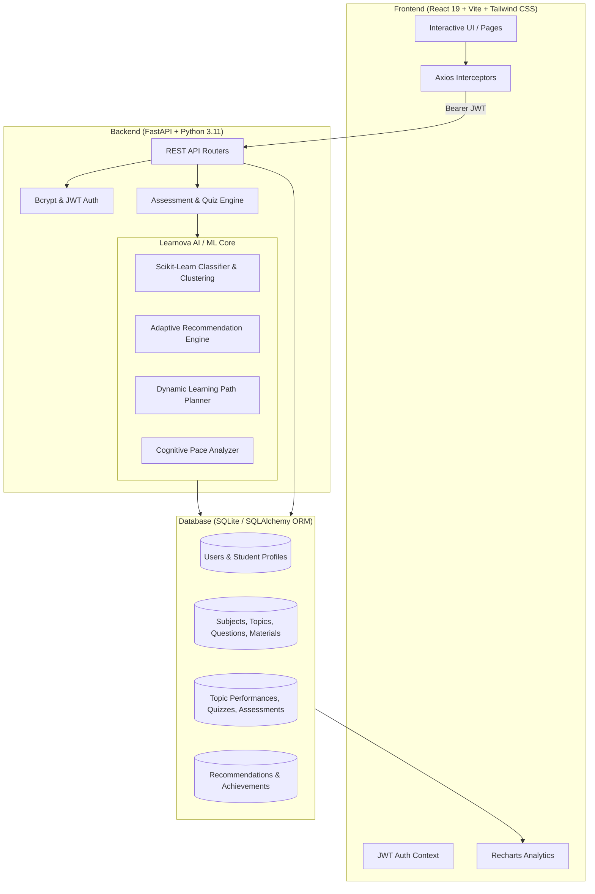

# LEARNOVA AI — Adaptive Personalized Learning Platform
> *"Your Learning Path. Powered by AI."*

A full-stack, enterprise-grade, AI-driven educational SaaS platform built as an academic final-year project. Learnova AI continuously tracks student performance across diagnostic assessments and topic-level quizzes, predicts cognitive knowledge tiers using machine learning, pinpoints conceptual weaknesses, and dynamically generates personalized prerequisite-aware learning paths.

---

## 🌟 Key Features

- **Diagnostic Assessment System:** Multi-topic balanced diagnostic tests with a real-time countdown timer, question palette navigator, and review flags.
- **Scikit-Learn ML Knowledge Classifier:** Categorizes students into *Beginner*, *Intermediate*, or *Advanced* tiers with probabilistic confidence scores and clustering.
- **Weak Topic Hotspot Detection:** Automatically flags topics with scores under 60% and triggers targeted remedial recommendations.
- **Prerequisite-Aware Learning Engine:** Dynamically generates sequenced learning paths where advanced modules unlock only after preceding prerequisites meet mastery thresholds (≥75%).
- **Adaptive Difficulty Tuning:** Calibrates materials and quiz challenges according to performance:
  - `< 50%` → Beginner content
  - `50% – 75%` → Intermediate content
  - `> 75%` → Advanced content
- **Transparent AI Recommendation Feed:** Generates clear, data-driven explanations for every recommended action (e.g., *"Recommended because your recent score in Functions is 48%"*).
- **Gamification & Learning Streaks:** Daily learning streak tracking, study minute calculations, and collectible milestone achievement badges.
- **Interactive Analytics Dashboard:** Built with Recharts, displaying chronological score trends, topic mastery indexes, and cross-subject distributions.
- **Administrative Oversight Console:** Real-time cohort analytics, institutional metrics (most difficult topic, popular subjects), and complete CRUD management over subjects, topics, MCQs, quizzes, and learning materials.

---

## 🏛️ System Architecture



---

## 💻 Technology Stack

### Frontend
- **React.js (v19)** with Vite bundler
- **Tailwind CSS (v4)** with `@tailwindcss/vite`
- **Framer Motion** for smooth transitions and card animations
- **Recharts** for interactive time-series, bar, and area charts
- **Lucide React** for clean modern iconography
- **Axios** with request & response interceptors for JWT token handling
- **Canvas-Confetti** for mastery milestone celebrations

### Backend
- **Python (3.11+)**
- **FastAPI** for high-throughput asynchronous REST APIs
- **SQLAlchemy 2.0** ORM for relational modeling
- **Pydantic (v2)** for strict request/response data validation
- **PyJWT** for stateless Bearer token authorization
- **Bcrypt** for secure salted password hashing

### AI / Machine Learning
- **Scikit-learn:** Decision tree classifier and K-Means clustering for knowledge level prediction.
- **Pandas & NumPy:** Statistical quartile distributions, performance moving averages, and cognitive pace calculations.
- **Rule-Based Adaptive Knowledge Tracing:** Prerequisite graph traversal, decay curves, and difficulty adaptation.

### Database
- **SQLite (Default):** Zero-configuration local database (`backend/learnova.db`).
- **Migration Ready:** Engineered using SQLAlchemy standard schema conventions, easily migrated to PostgreSQL or MySQL by setting the `DATABASE_URL` environment variable.

---

## 🧠 AI / ML Methodology Explained

### 1. Knowledge-Level Classification
The ML engine extracts a 4-dimensional feature vector for each learner:
$$\mathbf{X} = [\text{average\_score}, \text{completion\_rate}, \text{high\_diff\_accuracy}, \text{consistency\_factor}]$$
A pre-fitted Decision Tree classifier predicts the student's mastery cluster:
- **Beginner (Cluster-BEG):** Foundational review prioritized.
- **Intermediate (Cluster-INT):** Core problem solving and applied modules.
- **Advanced (Cluster-ADV):** Edge cases, performance tuning, and complex design patterns.

### 2. Weighted Moving-Average Mastery
Topic scores adapt over time using an exponential moving average weighting:
$$\text{Score}_{\text{new}} = 0.65 \times \text{Score}_{\text{session}} + 0.35 \times \text{Score}_{\text{previous}}$$
This balances recent performance while preserving historical mastery.

### 3. Difficulty Adaptation Algorithm
$$\text{Content Difficulty} = \begin{cases} \text{Beginner}, & \text{if Score} < 50\% \\ \text{Intermediate}, & \text{if } 50\% \le \text{Score} \le 75\% \\ \text{Advanced}, & \text{if Score} > 75\% \end{cases}$$

### 4. Recommendation Priority Categories
1. **Practice More (Priority 1):** Triggered when topic score $< 60\%$.
2. **Learn Next (Priority 2):** Identifies the next sequential topic in the syllabus whose prerequisites have achieved $\ge 65\%$ mastery.
3. **Challenge Yourself (Priority 3):** Triggered when a student achieves $\ge 80\%$ in a topic, unlocking advanced quizzes.
4. **Revise (Priority 4):** Spaced repetition alerts for topics unvisited in $> 5$ days.

---

## 🗄️ Database Schema

| Table | Primary Purpose | Key Fields |
|---|---|---|
| `users` | User credentials & roles | `id`, `name`, `email`, `password_hash`, `role` ("student" / "admin") |
| `student_profiles` | Academic settings & goals | `education_level`, `preferred_learning_style`, `target_subject`, `streak_days`, `knowledge_level` |
| `subjects` | Curriculum disciplines | `id`, `name`, `description`, `icon`, `code` |
| `topics` | Fine-grained conceptual units | `id`, `subject_id`, `name`, `difficulty`, `order_index`, `prerequisites` |
| `questions` | MCQ items bank | `id`, `topic_id`, `question_text`, `option_a..d`, `correct_answer`, `explanation` |
| `assessments` | Diagnostic test attempts | `id`, `student_id`, `subject_id`, `score`, `total_questions`, `percentage` |
| `assessment_answers` | Per-question diagnostic selections | `assessment_id`, `question_id`, `selected_answer`, `is_correct` |
| `quizzes` | Timed topic micro-quizzes | `id`, `topic_id`, `title`, `difficulty`, `time_limit` |
| `quiz_attempts` | Submitted quiz scores | `id`, `student_id`, `quiz_id`, `score`, `percentage`, `time_taken_seconds` |
| `learning_materials` | Notes & reading guides | `id`, `topic_id`, `title`, `content_type`, `markdown_content`, `url` |
| `student_topic_performance` | Real-time topic mastery | `student_id`, `topic_id`, `score`, `mastery_level`, `attempts` |
| `recommendations` | AI generated suggestions | `student_id`, `topic_id`, `recommendation_type`, `reason`, `priority`, `status` |
| `achievements` | Gamification badges | `id`, `name`, `code`, `description`, `icon`, `criteria_type`, `criteria_value` |
| `student_achievements` | Unlocked badges mapping | `student_id`, `achievement_id`, `unlocked_at` |
| `notifications` | Real-time student alerts | `student_id`, `title`, `message`, `notification_type`, `is_read` |

---

## 🚀 Step-by-Step Installation & Running Guide

### Prerequisites
- Python 3.10+ installed
- Node.js 18+ and npm installed

---

### Step 1: Clone or Open Workspace
Open the root directory in **Visual Studio Code**:
```bash
cd "d:\Projects\AI Personalized Learning"
```

---

### Step 2: Install Dependencies

#### Python Backend:
```bash
pip install -r requirements.txt
```

#### React Frontend:
```bash
cd frontend
npm install
cd ..
```

---

### Step 3: Run the Application

You can use the provided Windows batch files or run directly from the VS Code integrated terminals:

#### Terminal 1 (Backend Server):
```bash
python -m uvicorn backend.app.main:app --host 127.0.0.1 --port 8000 --reload
```
*API Swagger Documentation will be available at: [http://127.0.0.1:8000/docs](http://127.0.0.1:8000/docs)*

#### Terminal 2 (Frontend Client):
```bash
cd frontend
npm run dev
```
*Application will be live at: [http://localhost:5173](http://localhost:5173)*

*(Alternatively on Windows, double-click `run_backend.bat` and `run_frontend.bat`)*

---

## 🔑 Pre-Seeded Academic Demo Accounts

The database automatically seeds realistic demo data with 6 subjects, 30+ topics, 20+ materials, and pre-configured accounts:

| Role | Email | Password | Pre-loaded Context |
|---|---|---|---|
| **Student** | `student@learnova.ai` | `Student@123` | Alex Mercer (CS Undergrad, 5-day streak, active topic performances in Python) |
| **Admin** | `admin@learnova.ai` | `Admin@123` | Administrator (Full access to student metrics, CRUD management over MCQs, topics, and materials) |

*💡 Tip: The Login page contains **1-Click Demo Buttons** for instant evaluation.*

---

## 🧪 Automated End-to-End Verification

The project includes an end-to-end verification test suite:
```bash
python backend/test_e2e.py
```
This tests:
1. Health check & API availability
2. 6 pre-seeded subjects with full topic graphs
3. Student login & profile verification
4. Diagnostic assessment test execution & scoring
5. Machine learning knowledge level classification
6. Strength and weakness detection
7. Prerequisite-aware learning path creation
8. Dynamic recommendation generation with explanations
9. Quiz execution, timing, and score persistence
10. Badge & gamification achievement unlocking
11. Admin login & institutional metrics
12. Admin CRUD operations (Create Subject, Add Topic, Add MCQ, Delete Subject)
13. New student account registration & validation

---

## 📑 REST API Documentation Summary

### Authentication
- `POST /api/auth/register` — Register student account
- `POST /api/auth/login` — Authenticate and receive JWT Bearer token
- `GET /api/auth/me` — Retrieve active authenticated session

### Diagnostic Assessment
- `GET /api/subjects/{id}/assessment-questions` — Fetch balanced diagnostic questions
- `POST /api/assessments/submit` — Submit assessment, update mastery, and trigger AI
- `GET /api/assessments/history` — Chronological assessment attempts
- `GET /api/assessments/{id}` — Assessment detail with answers and explanations

### AI / Machine Learning Engine
- `GET /api/ai/analysis` — Full ML knowledge tier, strengths, weaknesses, and pace
- `GET /api/ai/recommendations` — Fetch personalized recommendations
- `POST /api/ai/recommendations/refresh` — Force recalculation of recommendations
- `GET /api/ai/learning-path` — Fetch prerequisite-ordered dynamic learning path

### Quizzes & Practice
- `GET /api/quizzes` — Browse topic quizzes with filters
- `GET /api/quizzes/{id}` — Fetch quiz questions with timer configuration
- `POST /api/quizzes/{id}/submit` — Score quiz, update topic performance, check badges

### Learning Materials
- `GET /api/materials` — Filter materials by subject, topic, difficulty, or content type
- `GET /api/materials/{id}` — View complete markdown notes and external links

### Student Profile & Gamification
- `GET /api/students/profile` — View educational preferences and goals
- `PUT /api/students/profile` — Update learning preferences
- `GET /api/students/performance` — Cumulative metrics and topic mastery index
- `GET /api/students/achievements` — Unlocked vs locked badges
- `GET /api/students/notifications` — Real-time alerts and notifications

### Administrative Operations
- `GET /api/admin/metrics` — Cohort metrics, difficult topics, and popular disciplines
- `GET /api/admin/students` — Student directory with test volume and streak metrics
- `DELETE /api/admin/students/{id}` — Remove student account
- `POST /api/admin/subjects` / `PUT` / `DELETE` — Subject CRUD
- `POST /api/admin/topics` / `PUT` / `DELETE` — Topic CRUD
- `POST /api/admin/questions` / `PUT` / `DELETE` — MCQ Bank CRUD
- `POST /api/admin/quizzes` / `PUT` / `DELETE` — Quiz CRUD
- `POST /api/admin/materials` / `PUT` / `DELETE` — Learning Material CRUD

---

## 🎓 Viva & Academic Defense Q&A

**Q1: How is the AI recommendation actually calculated?**  
*A:* Rather than hardcoded outputs, Learnova AI aggregates student assessment answers and calculates topic accuracy. It queries the topic graph for prerequisite completion. Topics scoring below 60% are flagged as weak topics and assigned priority 1 recommendations. Unlocked unmastered modules become "Learn Next", while topics with $\ge 80\%$ scores unlock advanced challenge content.

**Q2: What machine learning algorithms are utilized?**  
*A:* A Scikit-learn Decision Tree Classifier analyzes multi-dimensional vectors (average score, syllabus completion rate, high-difficulty accuracy, and consistency) to categorize students into Beginner, Intermediate, and Advanced tiers. K-Means clustering groups learners with comparable performance profiles.

**Q3: How are prerequisites enforced?**  
*A:* Topics in the database include a `prerequisites` field. The `learning_path_service` verifies that all prerequisite topics have attained $\ge 65\%$ mastery in `student_topic_performance` before unlocking dependent topics.

---

## 📄 License
Open-source academic project for educational demonstration, viva examination, and portfolio review.
